# Vital

**An AI health and training coach for iPhone.** Vital reads your Apple Health and WHOOP data, works out what is normal *for you*, and tells you in plain language what to do today. Every number the coach quotes is checked against your real data before you see it.

  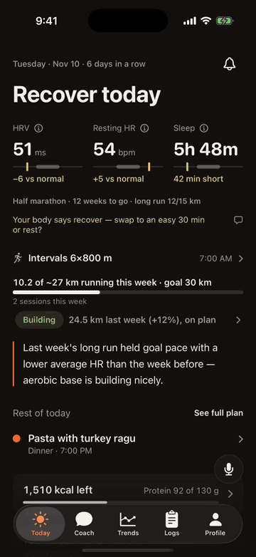

  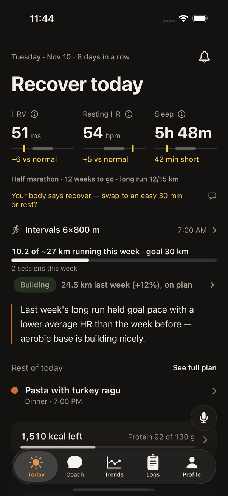
  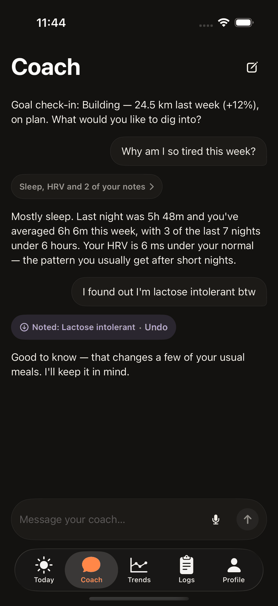
  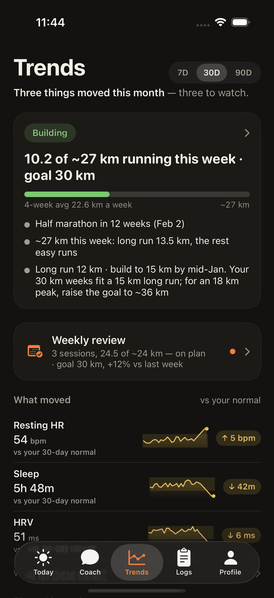
  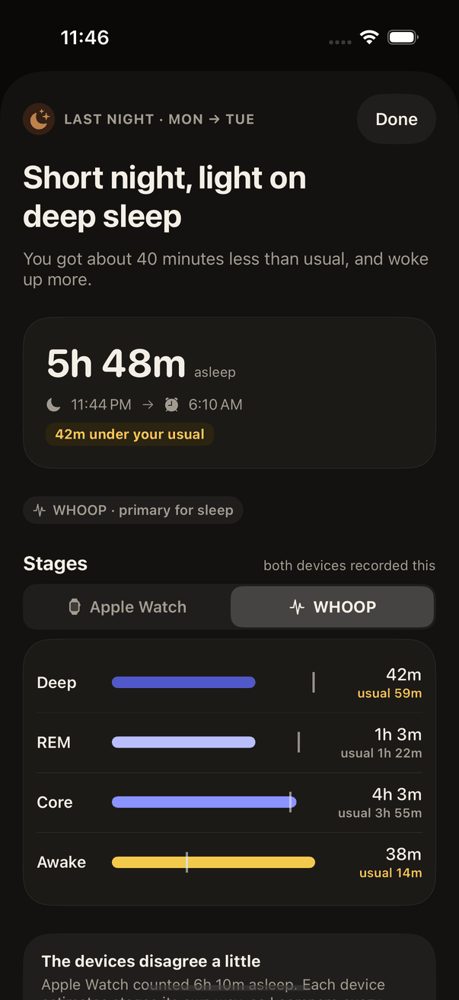

> **Status:** complete and no longer in active development. Built solo between May and November 2026 as a personal training tool, then shipped to TestFlight for a small group of testers. The hosted backend and database were retired in November 2026, so the app no longer runs against a live server; the code, tests and fixture-driven UI tests all still build. All screenshots show fixture data, not a real person.

## What it does

| | |
|---|---|
| **Today** | One verdict for the day (train, go easy, recover) with HRV, resting heart rate and sleep shown against your own normal range, your next session, and what is left of your food budget. The layout changes with your goal: endurance, muscle, weight loss or general health. |
| **Coach** | A chat that can query your real time-series data, log meals, change your plan and remember facts about you. Each answer carries a receipt showing which data and notes it used. Voice input and spoken replies are built in. |
| **Trends** | What moved this week or month, judged against a 30-day baseline. A metric is only called "above" or "below" normal once there is enough history to say so. |
| **Proactive analysis** | After a workout or a night's sleep, a background worker writes a short analysis and sends a push notification. A morning brief and a weekly review do the same on a schedule. |
| **Logging** | Meals by photo, barcode, search or voice; lifts; weight. Meals already logged elsewhere arrive through Apple Health. |
| **Memory** | A screen listing everything the coach knows about you, where each fact came from, and controls to correct or remove it. |

  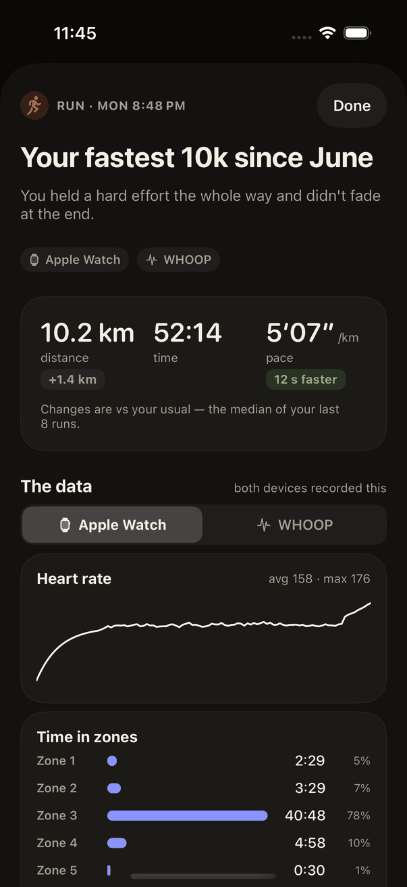
  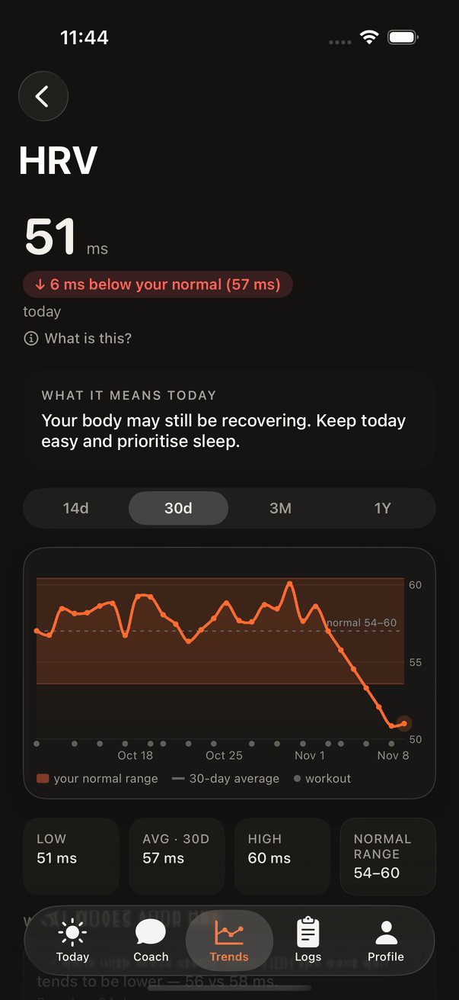
  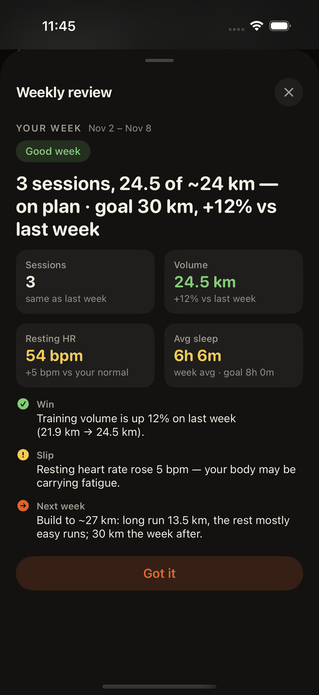
  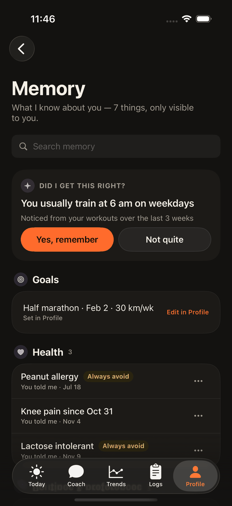

Light mode and Dynamic Type are supported throughout:

  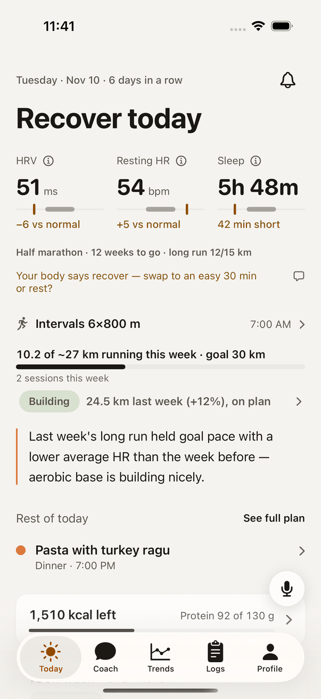
  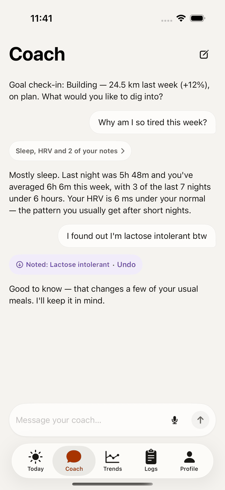
  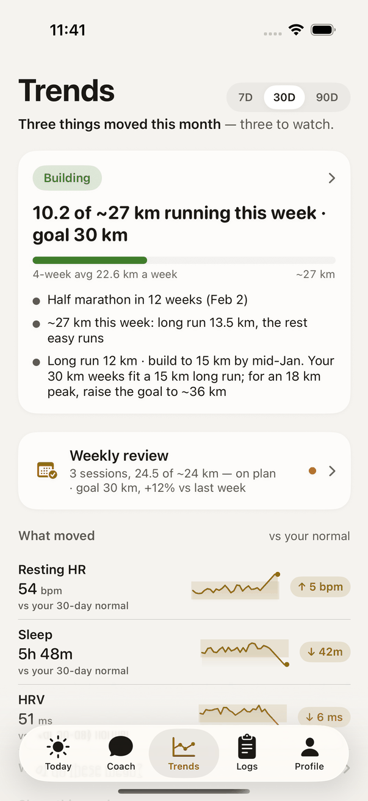
  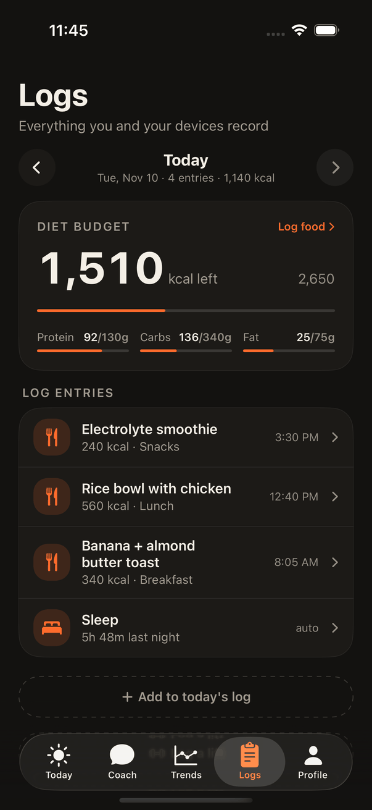

## Architecture

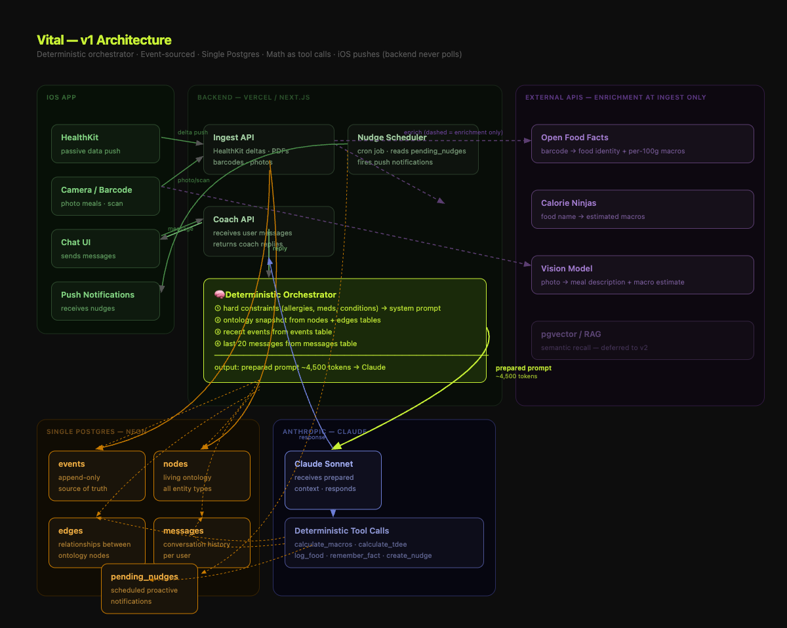

- **iOS app**: native SwiftUI. HealthKit sync with a resumable 365-day backfill and background delivery, Sign in with Apple, streaming chat over SSE, on-device speech-to-text, APNs.
- **API**: Next.js route handlers (TypeScript), JWT-gated, 63 routes. The coach is a multi-turn streaming tool-use loop on Claude with 22 tools.
- **Worker**: a second process that claims analysis jobs, writes morning briefs, runs the insight detectors, syncs WHOOP and delivers pushes.
- **Database**: Postgres (Supabase) through Drizzle ORM. 28 tables, 40 committed migrations.
- **Hosting**: Fly.io, two processes in one app. Every merge to `main` tagged a version, migrated the database, deployed the backend and uploaded a TestFlight build in a single workflow run.

Setup instructions and a full tour of the code are in [docs/DEVELOPMENT.md](docs/DEVELOPMENT.md).

## Engineering problems worth reading about

**Keeping an LLM honest about numbers.** Health advice with a wrong number in it is worse than no advice. Analyses are generated against a set of evidence tokens, and a grounding pass rejects any output whose figures do not trace back to the data it was given. Failed generations fall back to a plain, correct summary instead of a confident wrong one. See `lib/proactiveAnalysis*.ts`.

**Tools instead of prompt stuffing.** The coach never receives raw time-series in its prompt. It asks for what it needs through tools (`lib/brain/tools.ts`), which keeps prompts small and makes every answer auditable: the app shows the tool calls as a receipt under the reply.

**Never show absence as zero.** A day with no reading stays `null` end to end. Recovery scoring drops a missing component from both the numerator and the denominator, and the coach withholds verdicts entirely until it has 14 days of baseline. Apple Watch HRV (SDNN) and WHOOP HRV (RMSSD) are never mixed into one baseline because they measure different things. See `lib/brain/recovery.ts` and `lib/brain/baselines.ts`.

**Statistical gating for insights.** Detectors for trends, level shifts, cadence breaks, lagged correlations and day-of-week effects only surface a finding after a Benjamini-Hochberg false-discovery correction, so the app does not invent patterns from noise. See `lib/insights/`.

**Memory that can be retracted.** Facts about the user have a lifecycle (active, resolved, superseded) and a source tier (confirmed by the user, or inferred by the coach). Saying "my knee is fine now" resolves the old fact everywhere it is read, instead of adding a contradicting one.

**Migrations that cannot drift.** After two production incidents caused by schema pushes, the release runs `scripts/ci-migrate.mjs`, which applies only committed migration files and fails the deploy unless the database ledger matches the journal exactly.

**Screenshot tests as a design review.** A UI test target drives the app through six fixture scenarios (new user, three goals, server error, onboarding) in light and dark mode with a pinned clock, and uploads about 140 screenshots on every pull request. No network is involved; a debug-only URL protocol serves fixtures. See `ios/Vital/UITests/ScreenshotTests.swift`.

## By the numbers

| | |
|---|---|
| Duration | May to November 2026, solo |
| Commits / merged PRs | 1,144 / 273 |
| Swift | 274 files, about 79,000 lines |
| TypeScript | 233 files, about 55,000 lines (excluding tests) |
| Tests | about 2,500 backend test cases and 1,600 XCTest methods |
| Database | 28 tables, 40 migrations |

## Stack

- **iOS:** SwiftUI, HealthKit, Swift Charts, XcodeGen, fastlane match, TestFlight
- **Backend:** Next.js 16 (App Router, API only), TypeScript, Drizzle ORM, postgres.js
- **AI:** Claude Sonnet via the Anthropic SDK: streaming tool use for chat, vision for meal photos, structured generation for analyses
- **Data sources:** Apple HealthKit, WHOOP (OAuth and webhooks), USDA FoodData Central, Open Food Facts
- **Infra:** Fly.io, Supabase Postgres, APNs, GitHub Actions

## What I learned

The short version. The full list, with the incident behind each point, is in [docs/LESSONS.md](docs/LESSONS.md).

- **AI coding agents need rules and evidence, not reminders.** Anything I said twice went into a checked-in rules file ([AI_COMMON.md](AI_COMMON.md)). A stronger model plans and reviews, a cheaper one edits, and "done" means a failing test now passes or a screenshot run is green.
- **Give the model tools, not data.** Twenty-two narrow tools replaced weeks of health data in the prompt. Answers got cheaper and better, and the app can show what the model looked at.
- **Tool results and tool descriptions are part of the prompt.** Results are trimmed where the tool runs, and a separate eval harness checks which tools the real model chooses, because unit tests cannot see prompt wording ([docs/prompt-evals.md](docs/prompt-evals.md)).
- **Manage context on purpose.** Conversations are cut at a four-hour gap, long-lived memory is stored separately from chat history, and the stable part of the prompt is cached with a marker that rolls through the tool loop.
- **Validate model output, then fall back.** Every analysis passes a schema check and a number-grounding check. When either fails, the user gets a plain correct summary and the failure is logged.
- **Model choice is a per-task decision.** The cheapest model failed the grounded-analysis task, and a deploy secret silently overrode the model set in code.
- **Polish is not validation.** I would put the next project in front of ten strangers in the first month.

**Case study:** [Five days of silent notification failures](docs/case-studies/notification-outage.md): a wrong first diagnosis, a fix that did not fix it, and what finally did.

## How it was built

I worked as the product owner, designer and reviewer, with AI coding agents (Claude Code and Codex) doing much of the implementation under rules checked into this repo: every change goes through a pull request, the planning model never edits code directly, and schema changes ship only as reviewed migration files. The rules are in [AI_COMMON.md](AI_COMMON.md). The write-ups of individual bugs and their root causes are in [docs/problems/](docs/problems/).
